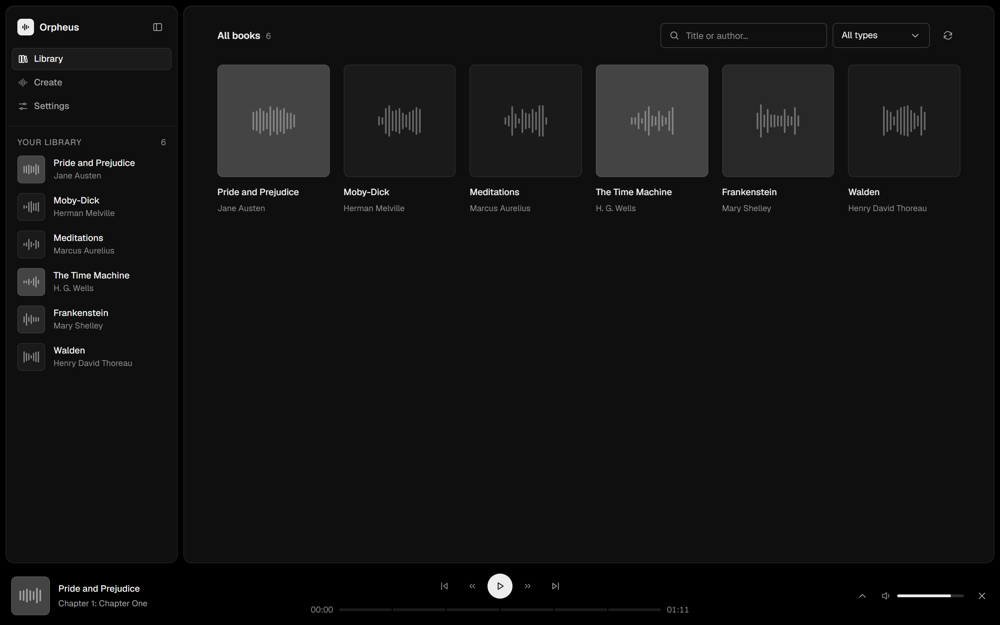
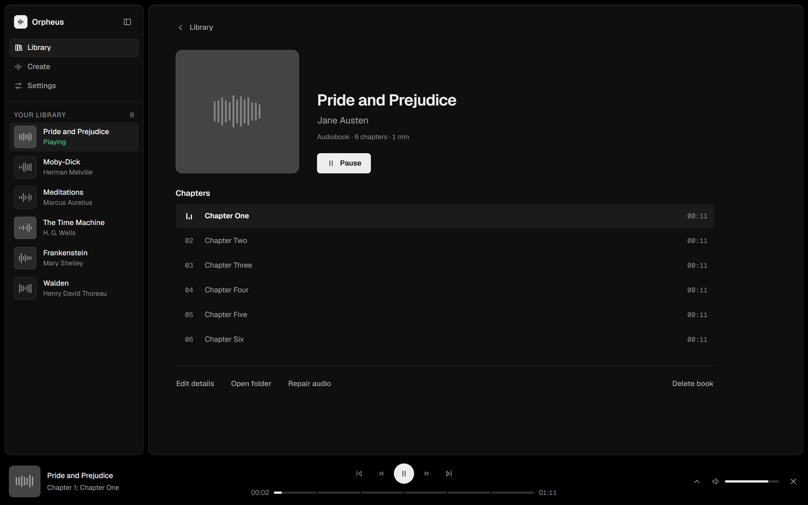
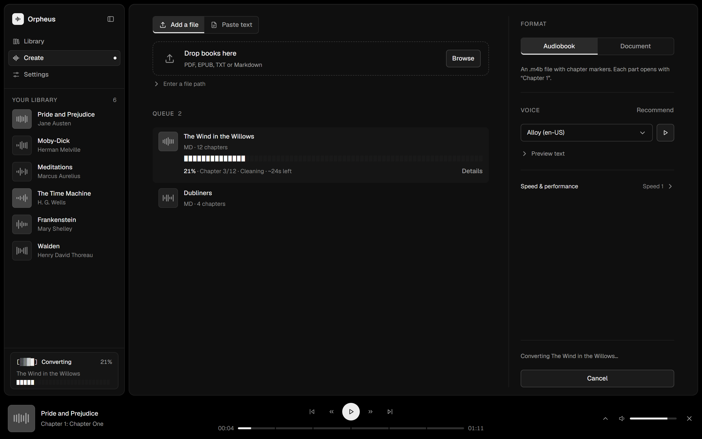
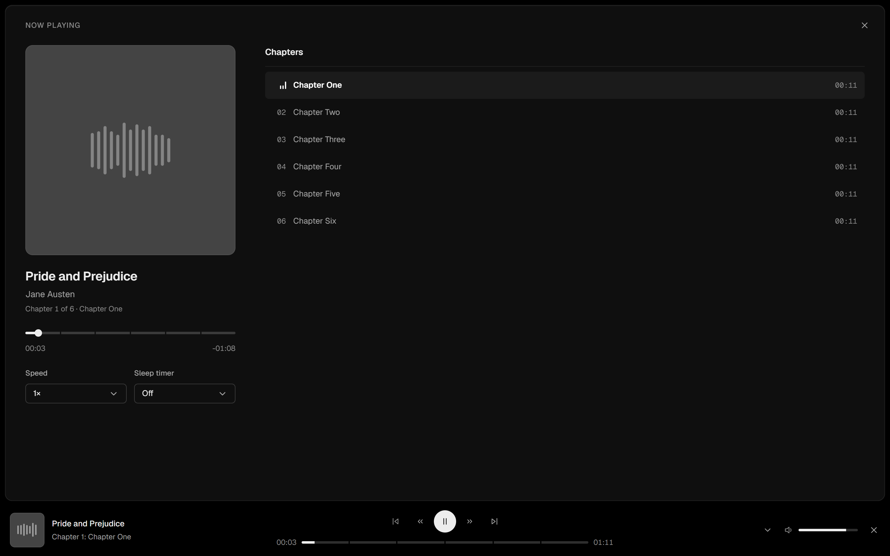
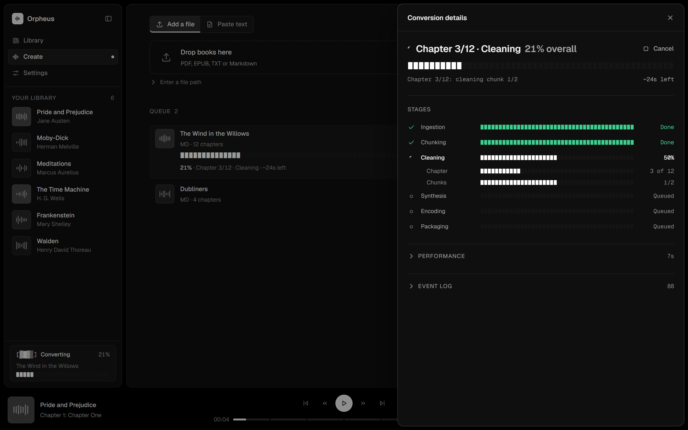
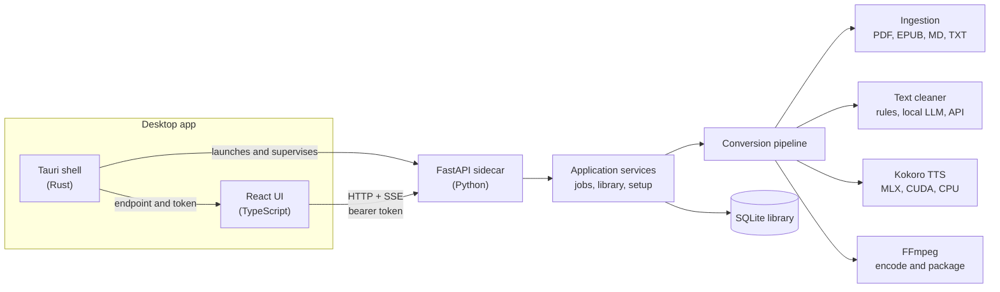

# Orpheus

Orpheus is a desktop app that turns PDF, EPUB, Markdown, and text files into
chaptered audiobooks, narrated on your own machine by the Kokoro
text-to-speech model.

It extracts the chapters, optionally cleans up extraction artifacts, narrates
each chapter (MLX on Apple Silicon, CUDA or CPU on Windows and Linux), and adds
the result to a local library with a built-in player. The app is a Tauri 2
shell with a React UI, driving a Python/FastAPI conversion engine and a SQLite
library.



## Features

- **Sources:** PDF, EPUB, Markdown, and plain text, from a file or pasted text.
  A preflight step shows the detected chapters and an estimate of the audio
  length before you convert. Empty, damaged, password-protected, and
  DRM-protected files are reported with a specific message.
- **Two output modes:** *Audiobook* produces an M4B with chapter markers,
  title, author, and narrator tags, and the source's cover; *Document*
  produces a single M4A.
- **Local narration:** Kokoro-82M runs on MLX (Apple Silicon), CUDA (NVIDIA),
  or CPU. Each chapter starts with its number and title, followed by a
  1.5-second pause, and ends with a 1.5-second pause. Audio is normalized to
  one loudness target, and a limiter holds sample peaks at -2 dBFS.
- **Optional text cleanup:** rule-based *Basic cleanup* with no model; a local
  LLM (Llama 3.2 on MLX, Qwen 2.5 on CUDA in 4-bit, 8-bit, or FP16); or any
  OpenAI-compatible API.
- **Library and player:** covers, editable titles and authors, chapter
  navigation, playback speed, a sleep timer, and saved playback position.
  Playback continues while you browse other books.
- **Queue:** add several sources and convert them in order with *Start all*.
  The queue is kept across restarts; a book that was converting when the app
  closed is flagged so you can check it in the library. Cancel asks before
  stopping a running book, and finished chapters are kept.
- **Recovery and maintenance:** a conversion interrupted by a backend restart
  is reported and can be repaired without starting over; a library check,
  backup, restore, and storage cleanup are built in.
- **Guided setup:** the first-launch Setup screen checks the runtime, downloads
  the selected models, and verifies that audio creation works. Models can be
  installed, repaired, or deleted later from Settings.
- **Local by design:** the backend listens on loopback only and requires a
  per-launch bearer token. After models are downloaded, conversion runs
  offline. Book text goes to a remote service only if you configure the
  OpenAI-compatible API cleaner or ask for an API voice suggestion.

## Screenshots

| Book page | Create |
| --- | --- |
|  |  |

| Now playing | Conversion details |
| --- | --- |
|  |  |

## Architecture



The Rust shell starts the Python backend on an ephemeral loopback port and
hands its address and session token to the React UI. The UI calls the backend
over HTTP and receives progress through server-sent events. Python owns
conversion and storage: it runs the pipeline (ingest, chunk, clean, synthesize,
encode, package) and records books in SQLite. Release builds bundle the backend
as a PyInstaller sidecar, so end users do not need Python.

See [docs/ARCHITECTURE.md](docs/ARCHITECTURE.md) for the full design.

## Platform Support

| Platform | Support |
| --- | --- |
| macOS 14+ on Apple Silicon | Primary release platform. Unsigned DMG builds use the local MLX runtime. |
| Windows 10/11 | One installer with CPU narration and Basic cleanup on PCs without an NVIDIA GPU. A supported NVIDIA GPU enables local LLM cleaning and faster narration. |
| Linux | Source only, best effort: not covered by CI, and no packaged release. CPU narration and NVIDIA CUDA runtimes use the `cuda` profile. |

The local LLM cleaner on Windows and Linux needs an NVIDIA GPU with a driver
that supports CUDA 12.6. The Windows installer is about 1.7 GB and installs
about 5 GB, because it bundles PyTorch with the CUDA libraries. Models download
separately on first launch and take about 0.7–0.9 GB on disk for the Kokoro
voice model, plus 0.8–6.4 GB for an optional local cleaner.

### Windows 11: Smart App Control

> [!WARNING]
> Orpheus is unsigned, so Windows may block it with **Smart App Control**.
> If blocked, open **Windows Security → App & browser control → Smart App
> Control settings → Off**, then launch Orpheus again.
>
> This turns off Smart App Control **for all apps**. Only do this for a build
> you trust, and read Windows' warning before confirming.
> [Microsoft's guidance](https://support.microsoft.com/en-us/windows/security/threat-malware-protection/smart-app-control-frequently-asked-questions).

## Install

### Release builds

Installers are published on the
[Releases page](https://github.com/gabrielmeleiro1/Orpheus/releases). They are
unsigned.

- **macOS (Apple Silicon):** follow
  [docs/UNSIGNED_MACOS_INSTALL.md](docs/UNSIGNED_MACOS_INSTALL.md) to verify
  the download and allow the first launch.
- **Windows:** run the installer, then open Orpheus from the Start menu. It
  installs per user under `%LOCALAPPDATA%\Orpheus` and installs Microsoft Edge
  WebView2 if it is missing. The installer includes the CUDA runtime, which
  also narrates on CPU when no NVIDIA GPU is present.

On first launch, the Setup screen asks you to choose the Kokoro voice model and
an optional cleaner, downloads them, and checks that audio creation works.
**Use library only** skips the downloads. Use **Settings → Voice & models** to
change models later, and **Settings → Storage** to see where data is kept.

### From source

Install the [system prerequisites](docs/DEPENDENCIES.md#system-prerequisites)
first: Git, Python 3.12, Node.js 22+, Rust 1.88+, and FFmpeg. Windows also
needs the [C++ Build Tools and WebView2](docs/DEPENDENCIES.md#windows).

A source checkout shares app data (`com.orpheus.desktop`) with an installed
Orpheus: `setup_runtime.py` replaces the installed app's runtime and model
selection, and `npm run desktop:dev` opens your real library. If Orpheus is
already installed, back up the library first with **Settings → Library → Back
up**.

macOS and Linux:

```bash
git clone https://github.com/gabrielmeleiro1/Orpheus.git
cd Orpheus
python3.12 -m venv .venv
source .venv/bin/activate
python -m pip install --upgrade pip
python scripts/setup_runtime.py --profile base
python -m pip install -r requirements-dev.txt
cd desktop
npm ci
npm run desktop:dev
```

Windows (PowerShell):

```powershell
git clone https://github.com/gabrielmeleiro1/Orpheus.git
Set-Location Orpheus
py -3.12 -m venv .venv
.\.venv\Scripts\python.exe -m pip install --upgrade pip
.\.venv\Scripts\python.exe scripts/setup_runtime.py --profile base
.\.venv\Scripts\python.exe -m pip install -r requirements-dev.txt
Set-Location desktop
npm.cmd ci
npm.cmd run desktop:dev
```

The Windows commands call the virtual environment's interpreter and `npm.cmd`
directly, so they work even when PowerShell blocks `Activate.ps1` and
`npm.ps1`.

The `base` profile covers the library, playback of existing audio, and source
inspection. Converting needs a local TTS runtime. Install the one that matches
your machine from the repository root:

```bash
# macOS 14+ on Apple Silicon (no PyTorch)
python scripts/setup_runtime.py --profile mlx --group tts-mlx --group cleaner-mlx

# Linux: CPU narration; add --group cleaner-cuda for the local LLM cleaner
# on a supported NVIDIA GPU with a CUDA 12.6 driver
python scripts/setup_runtime.py --profile cuda --group tts-cpu-cuda
```

```powershell
# Windows: CPU narration; add --group cleaner-cuda for the local LLM cleaner
# on a supported NVIDIA GPU with a CUDA 12.6 driver
.\.venv\Scripts\python.exe scripts/setup_runtime.py --profile cuda --group tts-cpu-cuda
```

Add `--dry-run` to see the exact install and download steps first. A debug
build run from this checkout can also install these runtimes from the Setup
screen. See [docs/RUN_APPLICATION.md](docs/RUN_APPLICATION.md) for setup
details, model management, and data locations.

## Development

Run these from the repository root with the virtual environment active (on
Windows, use `.\.venv\Scripts\python.exe` and `npm.cmd`).

| Task | Command |
| --- | --- |
| Run the desktop app | `cd desktop && npm run desktop:dev` |
| Run the backend alone | `python -m apps.launchers.desktop_backend --host 127.0.0.1 --port 0` |
| Lint Python | `python -m ruff check .` |
| Python test gate | `python run_tests.py --contract` |
| Frontend checks | `cd desktop && npm run typecheck && npm test -- --run` |
| Rust checks | `cd desktop/src-tauri && cargo test --locked -- --test-threads=1 && cargo check --locked` |
| All source gates, with logs | `python scripts/check_desktop.py` |
| Package the app | `cd desktop && ORPHEUS_RUNTIME_PROFILE=base npm run desktop:build` |
| Install the pre-push hook | `bash scripts/install-git-hooks.sh` |

`ORPHEUS_RUNTIME_PROFILE` (`base`, `mlx`, or `cuda`) selects the runtime
bundled into a packaged build; install that profile first. In PowerShell, set
it with `$env:ORPHEUS_RUNTIME_PROFILE = "base"` and put `.venv\Scripts` first
on `PATH`, because the build hook calls `python`
([details](docs/RUN_APPLICATION.md#build-the-desktop-bundle)). On macOS,
`npm run desktop:release` builds the app and replaces
`/Applications/Orpheus.app`.

The `Source validation` GitHub Actions workflow
(`.github/workflows/source-validation.yml`) runs lint, the Python gate,
frontend tests and build, and Rust tests on macOS and Windows. It does not
package or publish releases. Releases go through a full local release gate,
`scripts/release_qualification.py`, described in
[docs/RELEASING_MACOS.md](docs/RELEASING_MACOS.md).

## Documentation

| Guide | Contents |
| --- | --- |
| [Architecture](docs/ARCHITECTURE.md) | Components, runtime contracts, API surface, and where to change things |
| [Dependencies](docs/DEPENDENCIES.md) | Prerequisites, runtime profiles, and model assets |
| [Running the app](docs/RUN_APPLICATION.md) | Setup, data locations, packaging, and installers |
| [Testing](docs/TESTING.md) | Test tiers, focused checks, and release verification |
| [Environment variables](docs/ENVIRONMENT.md) | Every setting the backend and shell read |
| [Runtime selection](docs/RUNTIME_SELECTION.md) | How the Kokoro provider is chosen per platform |
| [Releasing on macOS](docs/RELEASING_MACOS.md) | Maintainer release procedure |
| [Unsigned macOS install](docs/UNSIGNED_MACOS_INSTALL.md) | End-user install steps for unsigned builds |

The full index is in [docs/README.md](docs/README.md).

## Repository Layout

| Path | Contents |
| --- | --- |
| `desktop/` | Tauri shell (Rust), React UI (TypeScript), and packaging |
| `apps/` | Backend launcher |
| `modules/` | API, application services, pipeline, ingestion, TTS, audio, and storage |
| `tests/` | Python unit, integration, property, and hardware tests |
| `scripts/`, `tools/` | Setup, builds, release qualification, and browser test harnesses |
| `requirements/`, `config/`, `security/` | Runtime profiles, release settings, and reviewed audit exceptions |
| `docs/` | Project documentation |

## Contributing

See [CONTRIBUTING.md](CONTRIBUTING.md). Report security issues as described in
[SECURITY.md](SECURITY.md).

## License

The Orpheus source code is licensed under the [MIT License](LICENSE).

Packaged builds also bundle third-party components under other licenses,
including AGPL-3.0 (PyMuPDF, EbookLib) and GPL-3.0 (espeak-ng,
`phonemizer-fork`). Read [THIRD_PARTY_LICENSES.md](THIRD_PARTY_LICENSES.md)
before redistributing a binary.
