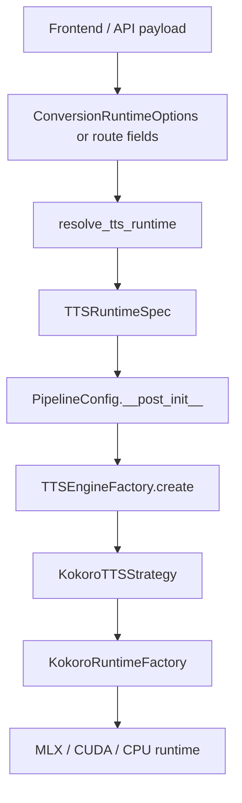

# TTS Runtime Selection

This page explains how Orpheus picks a Kokoro TTS provider on each platform,
and how that choice flows from the UI or API through `TTSRuntimeSpec` into the
engine factory.

## Platform default provider (Kokoro)

`TTSRuntimeSpec.default_provider("kokoro")` in `modules/tts/runtime_spec.py`
is the single source of truth when the caller does not set `tts_provider`.

| Platform | Condition | Default provider | Default model |
|----------|-----------|------------------|---------------|
| macOS Apple Silicon | `Darwin` + `arm64` / `aarch64` | `mlx` | `mlx-community/Kokoro-82M` |
| Windows / Linux with CUDA | a small CUDA kernel runs successfully | `cuda` | `hexgrad/Kokoro-82M` |
| CPU-only (no MLX, no CUDA) | fallback | `cpu` | `hexgrad/Kokoro-82M` |

Notes:

- MLX is only considered on Apple Silicon. The CUDA check imports `torch`,
  requires `torch.cuda.is_available()`, and then runs and synchronizes a tiny
  kernel, so a broken driver falls back to CPU.
- The MLX engine appends the quantization suffix at load time, so downloads
  and cache checks use the concrete `mlx-community/Kokoro-82M-bf16` repository.
- Kokoro is the only shipped engine; any other engine name would default to
  provider `local`.
- An explicit `tts_provider` or `tts_device` from the API always overrides
  these defaults.

## Decision flow

### Layer responsibilities

| Layer | Module | Role |
|-------|--------|------|
| API | `modules/web/routes/conversions.py`, `voices.py` | Accepts `tts_provider`, `tts_device`, nested `runtime_options` |
| App | `modules/app/services/conversion_runtime.py` | Normalizes user options into `ConversionRuntimeOptions` |
| Resolution | `modules/tts/runtime_options.py` → `resolve_tts_runtime` | Merges explicit `tts_runtime` with options; fills default provider |
| Identity | `modules/tts/runtime_spec.py` → `TTSRuntimeSpec` | Canonical provider, engine, model, quantization, device, options |
| Pipeline | `modules/pipeline/models.py` → `PipelineConfig` | Derives `tts_engine`, model, quantization from resolved spec |
| Factory | `modules/tts/factory.py` → `TTSEngineFactory` | Instantiates strategy from engine name + `factory_kwargs()` |
| Runtime | `modules/tts/runtimes/kokoro_*.py` | Provider-specific Kokoro implementation (MLX, package/CUDA, CPU) |

When `runtime_spec` is absent on a Kokoro strategy config,
`KokoroRuntimeConfig.from_strategy_config` calls `TTSRuntimeSpec.from_legacy`
without a hardcoded provider so platform defaults apply.

## Capability probes

Runtime availability for the desktop/API UI is probed separately from pipeline
execution:

- **MLX TTS**: `RuntimeCapabilityService.probe_mlx_tts_runtime()` (subprocess or
  in-process when frozen).
- **CUDA cleaner/TTS**: `probe_cleaner_backend("cuda")` validates `torch`, GPU
  presence, and optional `bitsandbytes` for default quantization.

Contract tests mock the `torch` import and `cuda.is_available()`. Real GPU runs
belong in explicit hardware smoke checks and GPU tests; see
[TESTING.md](TESTING.md#gpu-tests).
