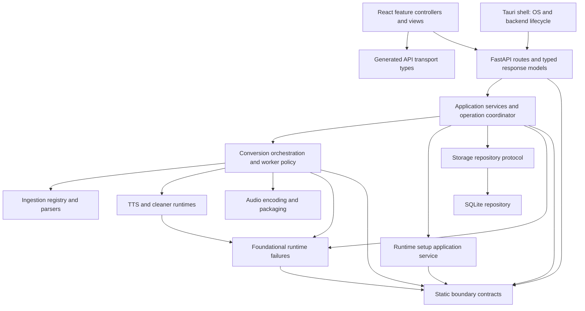

# Orpheus Architecture Modernization Design

**Date:** 2026-07-28

**Status:** Approved for detailed planning

**Scope:** Internal architecture, modularity, correctness, performance safeguards, and developer usability

**Compatibility policy:** Preserve user-facing HTTP contracts, persisted SQLite data, generated audiobook artifacts, desktop lifecycle behavior, and documented CLI commands. Internal Python imports, test-only shims, and undocumented compatibility aliases may change after their in-repository callers migrate.

## Executive assessment

Orpheus does not need a rewrite. Its high-level topology is appropriate for the
product:

```text
React desktop UI -> local FastAPI backend -> application services
                                      -> conversion pipeline
                                      -> SQLite/filesystem storage
Tauri shell      -> backend and OS-process lifecycle
```

The repository also contains several patterns worth protecting:

- generation-fenced backend lifecycle handling in Rust;
- stage-then-commit deletion of managed library artifacts;
- transactional SQLite migrations and corruption recovery;
- reducer-based conversion and event-stream state machines;
- explicit TTS runtime identities and provider adapters;
- atomic final publication of conversion outputs;
- CSS tokens and feature-oriented React directories;
- extensive regression coverage around concurrency and failure paths.

The main problem is not an absence of layers. It is that important boundaries
are documented but rarely enforced, while the most stateful components still
combine too many responsibilities. The 2026-07-27 deep-clean pass removed dead
code and completed the safe pure-move decompositions. The remaining work is
structural: introduce explicit collaborators, static contracts, and state
machines, then retire transitional mechanisms.

The recommended approach is a contract-first incremental redesign. It avoids
both a high-risk rewrite and another cosmetic file-splitting pass.

## Current-state evidence

The review was performed against branch `feature/full-breaking-fix-pass` at
`e640ece`, after the recorded 2026-07-27 deep-clean work.

### Repository scale

| Area | Files | Approximate source lines |
| --- | ---: | ---: |
| `modules/app` | 18 Python files | 5,881 |
| `modules/web` | 20 Python files | 2,362 |
| `modules/pipeline` | 36 Python files | 10,060 |
| `modules/ingestion` | 13 Python files | 3,459 |
| `modules/tts` | 43 Python files | 9,513 |
| `modules/audio` | 5 Python files | 1,312 |
| `modules/storage` | 10 Python files | 2,832 |
| `scripts` | 13 Python files | 10,294 |
| `tools` | 16 Python files | 4,848 |
| `desktop/src` | 173 TS/TSX files | 31,013 |
| `desktop/src-tauri/src` | 7 Rust files | 7,179 |

Large files are symptoms, not the primary diagnosis. The most important
hotspots are:

| File | Lines | Architectural issue |
| --- | ---: | --- |
| `modules/app/services/conversion_service.py` | 952 | job reservation, threading, pipeline execution, persistence, events, cancellation, and engine reuse share state |
| `desktop/src/features/library/useLibraryList.ts` | 908 | query, pagination, selection, request ownership, entity actions, preview, mutations, and presentation messages share refs |
| `modules/pipeline/stages/synthesis.py` | 827 | synthesis scheduling, accumulation, profiling, fallbacks, and file/in-memory result handling |
| `modules/ingestion/epub_sections.py` | 823 | EPUB navigation, section extraction, metadata, and filtering |
| `modules/app/services/library_service.py` | 791 | uploads, catalog reads, metadata, previews, path policy, deletion transactions, and folder operations |
| `modules/storage/sqlite_repo.py` | 785 | connection lifecycle, recovery, mapping, queries, and mutations |
| `modules/pipeline/pool_manager.py` | 746 | executor lifecycle, startup probing, run tracking, cancellation, progress, and telemetry |
| `desktop/src-tauri/src/setup.rs` | 1,775 | setup contract, sanitization, platform process control, progress parsing, supervision, and Tauri commands |

### Boundary and contract findings

1. The intended Python dependency flow is documented, but only the web-layer
   prohibition against importing `pipeline` and `tts` has a dedicated automated
   boundary test.
2. `tts.device_memory` lazily imports cleaner-memory estimation from
   `pipeline`, creating the documented `pipeline <-> tts` near-cycle.
3. Setup layering is inverted across four production modules:
   `modules/web/routes/setup.py`, `modules/web/setup_status_cache.py`,
   `modules/web/server.py`, and
   `modules/app/services/model_download_service.py` import implementation from
   `scripts.setup_runtime` and/or `scripts.download_models`; the route also
   calls private script functions. Production behavior therefore depends on
   CLI implementation details.
4. Two additional foundational-boundary debts exist:
   `modules/contracts/source_extensions.py` imports the storage `SourceType`
   enum, and `modules/storage/maintenance_reconcile.py` imports title
   sanitization from `pipeline.book_workspace`. The source manifest and a pure
   book-identity/path contract remove these upward dependencies.
5. Conversion options are represented by:
   - a runtime-created dataclass in
     `modules/contracts/conversion_runtime_options.py`;
   - a runtime-created Pydantic request model in
     `modules/web/routes/conversions.py`;
   - hand-written TypeScript interfaces;
   - normalized application options;
   - `PipelineConfig`;
   - a manually serialized worker dictionary.
   Field synchronization is partly tested, but the core DTO is not statically
   visible to Python type checkers and the TypeScript surface is not generated
   from the API schema.
6. Source formats are repeated in Python, React copy, Rust file-picker filters,
   and tools. Their mode restrictions and labels can drift because there is no
   executable cross-language source-format contract. `.markdown` is not
   accepted anywhere today; adding it is an additive improvement that must land
   atomically across manifest, picker, upload/preflight, and ingestion.
7. API responses are primarily untyped dictionaries. The same job and book
   shapes are assembled by route handlers and serializers without response
   models enforcing the OpenAPI contract.
8. `modules/errors.py` defines 20 `ErrorCode` members, seven of which have no
   production reference (`E006`, `E102`, `E200`, `E201`, `E302`, `E400`,
   `E401`). The codes that are used are normally flattened to exception strings
   before the API boundary, so the taxonomy does not currently provide a stable
   machine-readable contract.

### Stateful component findings

1. `ConversionService` owns one lock that protects active jobs, global storage
   cleanup, and per-book cleanup. Its command objects call private service
   methods and inspect private service attributes. `AppController` also exposes
   compatibility wrappers that reach back into private conversion-service
   methods.
2. `SharedWorkerPoolManager` owns executor construction, health probing,
   lifecycle transitions, current-run bookkeeping, cancellation, result
   collection, progress reporting, and long-lived metrics. Helper files created
   by the deep-clean pass have single consumers, so the package is simultaneously
   over-decomposed at its leaves and under-decomposed at its stateful center.
3. Worker selection is decided across runtime-option normalization,
   `PipelineConfig.__post_init__`, worker-plan construction, memory policy,
   adaptive chapter dispatch, and pool capacity. A developer cannot inspect one
   component to explain the final worker count.
4. `useLibraryList` uses multiple generation counters, request factories,
   abort controllers, state variables, and mutable mirrors. The race fencing is
   careful and well tested, but ownership rules are encoded procedurally across
   one hook instead of in a reducer and request coordinator.

### TTS and memory findings

1. The public strategy path wraps provider runtimes, while the MLX runtime wraps
   the older `TTSEngine` facade. Two TTS configuration classes also exist.
2. `engine_runtime.py`, `engine_output.py`, cleaner backends, cleaner trace
   helpers, and cleaner transport helpers mutate or inspect private attributes
   on their owning facade. These modules are physically separate but not
   modular: their real interface is the facade's private object layout.
3. Cleaner backend "strategies" receive the `TextCleaner` facade and mutate its
   `_model`, `_tokenizer`, `_loaded`, counters, and internal methods. Backend
   state therefore has no clear owner.
4. Memory handling is split among:
   - `VRAMManager` for sequential model ownership;
   - `AdaptiveMemoryManager`/`VRAMMonitor` for on-demand batch pressure;
   - an unused background monitor and idle-timeout lifecycle;
   - `DeviceMemoryPolicy` for provider-aware sampling/estimation;
   - `SafeMemoryPolicy` for worker sizing.
   The `TTSEngine` actively uses synchronous `refresh()` and batch sizing, so
   the entire monitor is not dead. However, production code never starts the
   background monitoring or `IdleTimeoutManager`; service-level idle unloading
   is instead implemented by `TtsEngineSession`.
5. Memory-pressure classification is repeated in TTS engine, cleaner errors,
   and pipeline retry logic. Broad substring markers such as `"memory"` can
   misclassify unrelated failures and become behavioral policy.

### Setup, tooling, and test findings

1. Packaged builds use profile-baked runtimes and report dynamic installation
   unavailable, but the release binary still compiles the full Rust setup
   supervisor. The actual installer is Python; Rust duplicates platform
   validation, process supervision, progress sanitization, and progress-state
   ownership around it.
2. The 1,762-line benchmark script is both CLI and benchmark library.
   `benchmarks/` imports it from `scripts/`, which inverts normal dependency
   direction.
3. There are three benchmark-result schema families and repeated cleaner/runtime
   configuration paths.
4. Twenty-six test files retain direct-script entry points in addition to pytest
   collection. `run_tests.py` therefore owns a second execution model and an
   explicit file list.
5. Python linting and coverage are strong, but there is no incremental Python
   static type gate. Across 158 Python files under `modules`, 84 contain broad
   `Any`-based contracts. This is most damaging at application, pipeline, and
   web boundaries.

## Chosen architectural approach

### Rejected: full rewrite

A rewrite would make the conceptual model cleaner quickly, but would discard the
current correctness knowledge embedded in thousands of tests. It is especially
risky for cancellation, process teardown, storage path safety, repair, packaged
runtime startup, and late-event fencing.

### Rejected: continue splitting files

The previous pass correctly stopped where extracted files would still mutate the
same shared state. More pure moves would produce additional forwarding modules
without reducing coupling.

### Selected: contract-first incremental redesign

The modernization will:

1. freeze observable behavior with characterization tests and benchmark
   baselines;
2. enforce the intended dependency graph;
3. make boundary DTOs static and generate frontend transport types;
4. extract explicit state owners from the two largest shared-state hotspots;
5. consolidate runtime, memory, and failure policy;
6. remove transitional compatibility code after all repository callers migrate;
7. ratchet type coverage, architecture checks, and performance gates.

Every phase leaves the repository releasable.

## Target architecture



### Dependency rules

1. `modules/contracts` contains static values and DTOs. It imports only the
   standard library and other `modules.contracts` modules—never another
   production package, including future/root `modules.*` packages.
2. `modules/web` imports only application façades and contracts, never pipeline,
   TTS, storage implementations, scripts, or tools.
3. `modules/app` coordinates use cases and depends on repository protocols. It
   may construct pipeline and TTS collaborators in the composition root, but
   application services receive protocols/factories rather than importing
   concrete implementations ad hoc.
4. `modules/pipeline` depends on ingestion, TTS, audio, and foundational
   contracts. It never imports app, web, scripts, or storage.
5. `modules/tts`, `modules/ingestion`, and `modules/audio` never import pipeline,
   app, web, storage, scripts, or tools.
6. `scripts`, `tools`, and `benchmarks` are adapters. Shared functionality lives
   in importable packages and never imports back from a CLI script.
7. React uses generated types for HTTP transport and hand-written types only for
   UI/view state. Tauri owns app-level OS integration and process lifecycle, not
   business rules. The existing backend `open book folder` endpoint remains a
   deliberate compatibility exception because its server-side path policy must
   resolve and validate the stored artifact directory before invoking the OS.
8. `modules/setup` and `modules/runtime_failures` are foundational packages:
   setup may depend on static contracts and runtime-profile values but not app,
   web, pipeline, TTS, storage, scripts, or tools; runtime failures depend only
   on static contracts/standard-library types and never on a consumer package.

These rules will be enforced by an AST-based test over all production modules,
not only the web package.

## High-level decisions

### DEC-01: Keep the desktop-first local-service topology

The Tauri + React + local FastAPI architecture remains. Moving conversion logic
into Rust or collapsing the API boundary would increase risk and reduce the
value of existing tests. Tauri stays thin.

### DEC-02: Treat application use cases as the primary modular boundary

`AppController` remains the external application façade and composition root,
but stateful work moves into focused services:

- `OperationCoordinator`: active-job, global-maintenance, and per-book
  reservations;
- `ConversionService`: validate and submit conversion/repair commands;
- `ConversionJobRunner`: execute a command, wire callbacks, update the job, and
  release resources;
- `SourceIntakeService`: upload, paste, and preflight;
- `LibraryCatalogService`: reads, metadata, playback, and previews;
- `LibraryDeletionService`: stage/commit/restore deletion;
- `RuntimeSetupService`: setup state, validation, probes, adoption, model
  download coordination, and deletion.

The façade delegates only through public methods. Services do not call each
other's private members.

### DEC-03: Use static boundary DTOs and generated transport types

Runtime-created dataclasses and request models will be replaced by explicit,
statically inspectable classes. Intentional mappings between API commands,
application options, normalized runtime plans, and pipeline configuration will
be explicit and tested.

FastAPI's OpenAPI schema becomes the source for generated TypeScript HTTP types.
UI-specific models remain hand written. CI fails if regeneration changes a
checked-in generated file.

### DEC-04: Make concurrency ownership explicit

Locks, generations, and cancellation primitives belong to named state owners.
Async or threaded operations receive immutable tokens containing the generation
and target identity. A token—not scattered comparisons against mutable refs—is
the authority to apply a result.

This applies to:

- application operation reservations;
- conversion job transitions;
- worker-pool lifecycle;
- library query/selection requests;
- TTS hot-engine ownership.

### DEC-05: Separate planning from execution

Runtime normalization produces an immutable `ConversionExecutionPlan` containing
resolved TTS/cleaner identities and a `ParallelExecutionPolicy`. The pipeline
executes the plan; it does not silently re-decide it in
`PipelineConfig.__post_init__`.

The final worker count is the result of one policy component with an explainable
decision record:

```text
requested -> backend capability -> contention guard -> memory limit
          -> chapter/workload limit -> pool capacity -> selected
```

Every reduction records a typed reason.

### DEC-06: Make runtime backends own their state

TTS and cleaner provider objects own models, tokenizers, caches, counters, and
load/unload state. Facades coordinate them through public protocols. Helper
modules receive explicit values or state objects instead of arbitrary facade
instances whose private fields they mutate.

`TTSRuntimeSpec` remains the immutable runtime identity. One provider execution
config exists per runtime. The legacy MLX engine becomes an internal runtime
implementation, not a second public architecture.

### DEC-07: Keep memory policy synchronous unless a background service is real

The active on-demand pressure sampling and adaptive batch sizing remain. The
unused background-monitor and idle-timeout lifecycle is removed after
characterization tests prove no production start path. `TtsEngineSession`
remains the owner of inter-job idle unloading.

Provider memory estimation lives with provider/runtime code. Pipeline memory
policy consumes a protocol and never needs TTS to import pipeline.

### DEC-08: Prefer typed failures over message classification

Runtime, memory, cancellation, validation, and infrastructure failures receive a
small stable `FailureKind` classification. Internal fallback decisions use
exception type/kind. String matching remains only as a compatibility adapter for
third-party exceptions at the provider edge.

HTTP errors become additive problem payloads with:

- `code`;
- `message`;
- `kind`;
- `retryable`;
- optional `stage` and `details`.

Existing `detail` text remains during the compatibility window.

### DEC-09: Use explicit registries for finite variant sets

The four source formats do not need a plugin framework. They need one explicit
registry describing suffixes, parser factories, preflight handlers, display
labels, and mode support. Backend validation and UI capabilities derive from
that registry.

A checked-in, validated source-type manifest supplies Rust compile-time
file-picker filters. A sync test prevents Python/Rust drift.

### DEC-10: CLIs are adapters, not libraries

Benchmark execution, setup planning, model receipts, release qualification, and
profile verification live in importable modules. `scripts/*.py` files parse
arguments, call a public function, and translate the result to an exit code.

Pytest becomes the only automated Python test runner. Smoke selection uses
markers or node IDs, not direct execution of test modules.

## Low-level component design

### Conversion and maintenance coordination

`OperationCoordinator` owns one lock and explicit reservation records:

```python
@dataclass(frozen=True)
class OperationToken:
    kind: Literal["job", "storage", "book"]
    generation: int
    owner_thread_id: int
    book_id: int | None = None
```

Its public operations are:

- `reserve_job(job) -> OperationToken`;
- `release_job(token, job)`;
- `reserve_storage_maintenance() -> OperationToken`;
- `reserve_book_maintenance(book_id) -> OperationToken`;
- `release(token)`;
- `active_job()`;
- `snapshot()`.

Ownership validation and conflict rules live here. `LibraryDeletionService` and
storage backup/cleanup use the coordinator directly; they no longer call methods
on `ConversionService`.

`ConversionJob` moves out of `controller.py` and implements synchronized,
one-way transitions:

```text
IDLE -> RUNNING -> COMPLETED | FAILED | CANCELLED
```

Terminal states cannot transition back. Pipeline attachment and result updates
are synchronized with the same job state object.

### Conversion execution

`ConversionService.start` performs:

1. cheap source/slot preflight;
2. request validation and runtime-plan resolution;
3. atomic job reservation;
4. durable source adoption;
5. job submission to `ConversionJobRunner`.

`ConversionJobRunner` receives a `ConversionCommand` protocol and a
`ConversionRunContext`. Commands do not receive the service object. Persistence
and event functions are explicit context collaborators.

Conversion and repair remain separate commands because their persistence and
artifact semantics differ. They share execution plumbing, not business logic
through private callbacks.

### Pipeline and pool state

The worker subsystem is organized into three cohesive components:

- `ParallelExecutionPolicy`: pure planning and reason reporting;
- `WorkerPoolLifecycle`: executor creation, health, startup probes, stopping,
  and shutdown;
- `ParallelRunTracker`: current job/chapter sets, progress, cancellation, and
  run-scoped metrics.

`SharedWorkerPoolManager` becomes a small coordinator over those components.
Single-consumer `pool_*` leaf helpers are either absorbed into the owning
component or retained only when they expose a real independently testable
contract.

### Frontend library state

Library state becomes one reducer with explicit actions for:

- query/filter replacement;
- initial page and appended page;
- selection and detail;
- loading/error/status;
- metadata/playback updates;
- deletion and repair completion;
- backend disconnect/reset.

`LibraryRequestCoordinator` owns abort controllers and generation tokens for:

- list context;
- selection context;
- mutation context.

The React hook orchestrates effects and translates completed requests into
reducer actions. It does not maintain mutable mirrors of reducer state except
inside the coordinator's tokens.

### Setup

Python setup logic moves under `modules/setup/`:

- `models.py`: static plans, status, receipt, and progress DTOs;
- `validation.py`: profile/model-group validation;
- `state.py`: lock, atomic state, backend adoption;
- `probe.py`: capability and installed-state probes;
- `downloads.py`: model-group resolution and receipt verification;
- `service.py`: application use cases.

The existing setup and model-download scripts become compatibility CLIs over
these modules. FastAPI setup routes depend on `RuntimeSetupService`, never on
`scripts`.

Rust setup code splits into:

- a small always-compiled command/status contract;
- a debug/source-checkout supervisor;
- a release stub that reports profile-baked setup as unavailable.

The backend lifecycle generation fencing and Windows Job Object behavior remain
unchanged.

### TTS and cleaner

The final public runtime surface is:

```python
class SpeechRuntime(Protocol):
    identity: TTSRuntimeSpec
    sample_rate: int
    def load(self) -> None: ...
    def warmup(self, ...) -> None: ...
    def synthesize(self, ...) -> AudioResult: ...
    def iter_synthesize_batch(self, ...) -> Iterator[AudioResult]: ...
    def unload(self, *, keep_in_cache: bool) -> None: ...
    def metrics(self) -> RuntimeMetrics: ...
```

MLX and package Kokoro runtimes implement it directly. Strategy/factory code
selects a runtime but does not introduce another mutable model owner.

Cleaner backends implement a similarly explicit lifecycle and return trace
results. Common rule-based normalization and preservation guards remain in the
coordinator.

### Storage

The SQLite repository remains a concrete adapter behind a repository protocol.
It is large but cohesive enough to refactor later by query group, after
application-service changes reduce monkeypatch coupling.

This is an intentional deferral, not an unreviewed hotspot. Splitting
`sqlite_repo.py` before Tasks 6-9 would duplicate transaction/recovery ownership
while its callers are still moving. Revisit it only after repository protocol
call sites are stable and characterization covers migration, corruption
recovery, transaction rollback, and concurrent reads. At that point, extract
connection/recovery, row mapping, queries, and mutations only where each unit
has an independent protocol and test boundary.

Pipeline `ConversionResult` and application/storage operation results receive
distinct names (`PipelineConversionResult`, `StoredConversionResult`) at their
definitions, not only through import aliases.

Deletion staging and migration behavior are protected unchanged.

### Synthesis and EPUB ingestion

The two other large orchestration hotspots are in scope:

- Task 13 makes `synthesis.py` a stage coordinator over a scheduler and a
  deterministic result accumulator. Scheduling/fallback ownership is separated
  from ordered file/in-memory result assembly and profiling.
- Task 18 makes EPUB package/navigation discovery distinct from section
  extraction/filtering/metadata assembly, then registers that adapter beside
  PDF, text, and Markdown through the common ingestion registry.

Neither change is accepted on line-count reduction alone. Their gates are
stable chapter ordering, fallback behavior, artifact selection, EPUB navigation
semantics, metadata, and throughput.

## Correctness and performance strategy

### Behavior characterization

Before structural changes:

- snapshot OpenAPI schema and representative JSON payloads;
- capture conversion/repair job transition traces;
- capture cancellation and maintenance conflict matrices;
- record library request race scenarios;
- record worker-selection decisions for CPU, MLX, CUDA, cleaner contention,
  manual mode, and unavailable-memory cases;
- capture packaged backend startup and setup-unavailable behavior;
- record deterministic conversion artifact manifests, durations, and metadata.

Audio bytes are not required to be identical when a runtime is nondeterministic.
Chapter count, ordering, playable artifact validity, duration tolerances,
metadata, and quality gates must remain equal or improve.

### Performance gates

Each performance-sensitive phase records before/after results with identical
inputs:

- API route and application orchestration latency;
- library list/detail render and request counts;
- parse/normalize throughput;
- time to first audio;
- real-time factor and total TTS throughput;
- peak process and device memory;
- worker startup/reuse/shutdown time;
- final packaging time and redundant probe/encode counts;
- packaged application startup time and bundle size.

Control-path refactors should stay within 5% of baseline. Hardware-backed TTS
comparisons use repeated runs and report median plus spread; a regression is not
accepted solely because one run is noisy.

### Verification layers

1. Focused unit tests for each changed state owner.
2. Cross-layer contract and import-boundary tests.
3. Python contract gate.
4. Frontend typecheck, Vitest, and production build.
5. Rust formatting, tests, and check.
6. Profile verification for affected runtime profiles.
7. Packaged-app build and smoke for Tauri/setup/sidecar changes.
8. Benchmarks for pipeline, TTS, memory, parser, and tooling changes.

## Migration sequence

1. Establish architecture, schema, behavior, and benchmark baselines.
2. Replace dynamic conversion DTOs and generate frontend transport types.
3. Centralize source-type metadata.
4. Introduce `OperationCoordinator` and move synchronized job state out of the
   controller.
5. Extract `ConversionJobRunner`, then split library intake/catalog/deletion.
6. Move setup domain logic out of scripts and gate Rust supervision by build
   mode.
7. Break the TTS/pipeline near-cycle, consolidate failure classification, and
   make worker planning explicit.
8. Refactor pool lifecycle and run tracking.
9. Make TTS and cleaner runtimes own their state; remove the legacy public MLX
   facade.
10. Replace the library hook's mutable state web with a reducer and request
    coordinator.
11. Add the ingestion registry and consolidate benchmark/tooling cores.
12. Remove internal shims, ratchet typing/coverage/architecture checks, and
    rewrite architecture documentation around the final boundaries.

## Success criteria

The modernization is complete when:

- every production package edge is mechanically enforced;
- no production module imports `scripts` or `tools`;
- frontend HTTP types are generated from the checked API schema;
- conversion options have static Python definitions and explicit mappings;
- conversion, maintenance, and library deletion share one named operation
  coordinator;
- command objects no longer call private service methods;
- worker selection is decided in one explainable policy;
- TTS and cleaner backends own their state without facade-private reach-ins;
- TTS does not import pipeline;
- unused background memory/idle mechanisms are removed while on-demand pressure
  behavior remains benchmarked;
- packaged builds do not compile source-checkout setup supervision;
- `useLibraryList` is a thin feature controller over a reducer and request
  coordinator;
- setup routes depend on an application service rather than CLI scripts;
- pytest is the single Python test execution model;
- Python static typing is enforced for contracts and new/changed application
  modules, with an expansion ratchet;
- all existing user-facing contracts remain compatible or receive an explicit,
  tested additive improvement;
- performance baselines show no unexplained regression.
